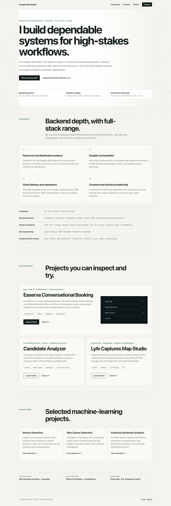

# Joseph Hernandez Portfolio

Public portfolio and index for three interactive engineering demos.



## Live site

<https://josephmhernandez.com>

## Architecture

- Amazon S3 private origin
- Amazon CloudFront with Origin Access Control
- ACM-managed TLS certificate
- Route 53 apex and `www` aliases
- CloudFormation-managed infrastructure

All demos share one static distribution. Easerva adds API Gateway WebSockets, Lambda, DynamoDB, and Claude through Bedrock. Candidate Analyzer uses a throttled Lambda API and Gemini. Map Studio uses an HTTP API, SQS worker, DynamoDB job state, and private S3 PDF output. Each backend is serverless and concurrency-limited to avoid idle compute charges.

## Deploy

```bash
aws cloudformation deploy \
  --stack-name jmh-portfolio-hosting \
  --template-file infrastructure/hosting.yaml
```

Upload the root site, then invalidate CloudFront after the demo builds have been copied into `demos/`.
